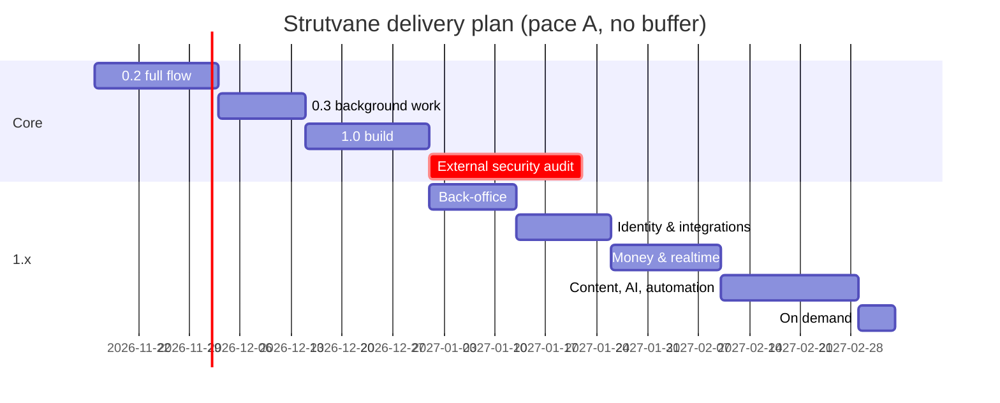

# 21. Delivery plan: what gets built, in what order, and when

- **As of:** 2026-11-16 (the live status dashboard in §0 is updated at every milestone)
- **Owner:** project lead (decisions) · coordinator (planning, verification, merges)
- **How to read this:**
  - §1 is the one-page overview.
  - §2 explains how the work is planned and checked.
  - §3 gives the release roadmap.
  - §4 goes package by package, with hours.
  - §5 is the exact order of the next steps.
  - §6 has the timeline in hours, days, weeks and months.
  - §7 covers risks.
  - §8 lists open decisions.
- **Estimates:**
  - Hours are **agent-hours**: the time AI agents spend building, testing, auditing, documenting and having the coordinator verify a package. They are honest estimates with about **±30% uncertainty**.
  - Calendar dates depend mainly on usage limits (§6), not on how fast the work itself goes.

---

## 0. Live status dashboard (updated 2026-11-21, ~20:25 IST — ⏸ stopped at 89% weekly usage)

This section is updated at every milestone and before every stop, together with the PDF copy. Every number comes from `STATE.md`; anything not re-run by the coordinator is marked *(agent-reported)*.

> **⏸ Stopped 2026-11-21, ~20:25 IST** at **89%** weekly usage (the lead: build until 90%). It resets on 25 Nov.
> - **Framework 0.2.0-next.2 is now LIVE.**
> - The two high auth fixes are done (local branch, release next).
> - The release-pipeline split is verified 3× (212 tests); it waits for the lead's `npm-release` environment steps.
> - **Live on npm as `latest`:** framework 0.2.0-next.1, ui, auth, design-crisp, design-vivid (0.2.0-next.1), redis, strutvane (npx), health and social-login (0.2.0-next.0).
> - **Security reviews of all 17 packages are done** (decision #134). No critical findings; the high findings are being fixed on local branches, and the details are in the private findings file only.
> - **The demo app does not run end to end yet:** 10 blockers (`C:\personal_projects\strutvane-demo\ACCEPTANCE.md`), with three fix branches started.
> - **Pushed:** every feature and demo branch. **Local only, on purpose:** the `fix/hardening-2026-11-20` branches and tooling `feat/release-hygiene`, because a public fix would point at a live weakness before its release.

**Definitions:**
- **Built:** the code is written.
- **Tested:** the full gate passes 3× in a row, re-run by the coordinator.
- **Pushed:** the work is on GitHub.
- **Merged:** it's on `main`.
- **Released:** it's on npm.
- **Docs:** the docs site describes it.
- **100% done** means all six are ✅.

### 0.1 Overall progress
| Measure | Value |
|---|---|
| Release 0.2 (full flow) | **~70% done.** The demo acceptance found 10 cross-package blockers that each package's own tests missed, so about 30–35 agent-hours are left |
| Released on npm (v2) | **9 packages live as `latest`**; framework 0.2.0-next.2 staged |
| Security | 5 reviews over 17 packages (2026-11-20). High findings: auth ×2, release pipeline, Postgres runtime role, and 2 in unreleased add-ons. All are being fixed or are tracked |
| Tests verified by the coordinator (2026-11-20) | framework `v2/gaps` **3,221** (3×) · redis 56 + 127 integration (3×) · npx 116 (3×) · health 149 · auth 864 + 64 (11-19) |

### 0.2 ✅ Done list (2026-11-20)
| Item | State |
|---|---|
| Framework 0.2 gaps: extension points, storage, `make:*`, model events | ✅ verified 3×, merged, **staged as 0.2.0-next.2** (waiting for approval) |
| `@strutvane/redis` 0.2.0-next.0 | ✅ **live** |
| `strutvane` (npx guard) 0.2.0-next.0, macOS fix | ✅ **live** |
| `@strutvane/health` 0.2.0-next.0 | ✅ **live** |
| `@strutvane/social-login` 0.2.0-next.0 | ✅ **live** (with a security fix pending: don't combine it with auth yet) |
| `scripts/npm-latest-check.mjs`; the release script synced into charts, import-export and search | ✅ |
| Decisions #132 (every `.env` key, several DBs), #133 (changelogs, versioning, releases), #134 (security for every package) | ✅ recorded |

### 0.3 ⏸ In progress (stopped; WIP committed)
| Work | Branch (head) | State |
|---|---|---|
| **auth security fixes** (high ×2 first) | auth `fix/hardening-2026-11-20` da3c6f5 (**local**) | high ×2 **done** (883 + 64, agent-reported); coordinator re-run, then release next |
| health + redis security fixes | health `fix/hardening-2026-11-20` 6fade90 (**local**); redis branch created, nothing committed yet | ~40% / 0% |
| Release pipeline hardening, changelogs, versioning | tooling `feat/release-hygiene` ecdd069 (**local**) | build/stage split done, **212 tests 3× verified**; waits for the lead's environment steps |
| Installer: macOS fixes | create-strutvane `fix/macos` 2565169 (pushed) | code done; Windows gate not yet 3× green in a row (machine load) |
| Installer hardening | create-strutvane `fix/hardening-2026-11-20` 26fad80 (**local**) | ~40% |
| Demo blockers: dev/build/start, manifest, logs, storage | framework `v2/app-runtime` 4ec741d | in progress |
| Demo blockers: CRUD on the ORM, migrate generation, authorization controls | framework `v2/data-crud` 617a1d5 | in progress |
| Demo blockers: auth registration, API prefix, policy style, seeder | auth/ui/skeleton `fix/demo` (b732d6d / 4ae59a1 / ef0ebff) | in progress |
| #132 `.env` keys + named DBs + DB role and TLS safety | framework `v2/env-connections` 46f7def; skeleton/installer `feat/env-keys` | in progress |
| Queues (0.3) | framework `v2/queues` ede99ea; RFC-0006 in the hub | paused by the lead (~30%) |

### 0.4 ⏭ Next (in order)
| Order | Item |
|---|---|
| 1 | Finish and release the auth security fixes (auth 0.2.0-next.2), then health and redis |
| 2 | Release pipeline hardening (build and stage split, main-only, lockfile checks), then sync to every repo |
| 3 | Installer: macOS + hardening gate 3×, then release |
| 4 | Demo blockers (runtime, CRUD/migrate, auth/ui/skeleton), then re-run the acceptance suite |
| 5 | #132 `.env` work; the lead's npm steps (move the stale `next` tags, deprecate v1, the release environment) |
| 6 | 0.3: queues, then mail, notifications, scheduler, cache (after the 25 Nov usage reset) |

### 0.5 🗓 After that
| Release | Packages | Target |
|---|---|---|
| 0.2.0 + demo app end to end | core train + demo fixes | **end of November 2026** (at risk: the demo blockers and security fixes come first) |
| 0.3 | queues, mail, notifications, scheduler, cache · queue-dashboard | **early December 2026** |
| 1.0 | files · charts · search · import-export · log-viewer (all need their security fixes first) · external audit | Feb 2027 |

### 0.6 Release timeline
| Release | Expected | Note |
|---|---|---|
| 0.2.0 + demo | 30 Nov 2026 | needs ~30–35 agent-hours after the 25 Nov reset, plus whatever fits before it |
| 0.3 | early–mid Dec 2026 | starts as soon as the 0.2 blockers are closed |

---

## 1. Overview

**Strutvane** is an MIT TypeScript framework that works like Laravel: `npm create strutvane@latest my-app` asks what you need, sets everything up (database, auth, admin UI), and `node strut migrate` turns a migration file into a working, secured API and admin screens.

| Release | What users get | Agent-hours | Earliest date | Date with buffer |
|---|---|---|---|---|
| **0.2: the full flow** | installer → migrate → API + admin UI, auth with every sign-in method, Crisp and Vivid designs | ~84 | **3 Dec 2026** | **8 Dec 2026** |
| **0.3: background work** | queues, mail, notifications, scheduler, cache, Redis, social login, AI-assistant setup | ~60 | 15 Dec 2026 | 24 Dec 2026 |
| **1.0: production-ready** | files (S3), search, import/export, inspector, monitoring, health, charts, dashboards, plus an external security audit | ~82 + audit | 1 Jan 2027 (audit +2–4 weeks) | **Feb 2027** |
| 1.x: back-office | activity log, settings, media library, tags, comments, PDF, GDPR tools, backups, API explorer | ~62 | 13 Jan 2027 | Feb 2027 |
| 1.x: identity and integrations | SSO, OAuth server, MCP server, feature flags, webhooks, GraphQL | ~67 | 26 Jan 2027 | Feb–Mar 2027 |
| 1.x: money and realtime | billing, invoicing, realtime, notification channels, boards/calendar, mail templates | ~73 | 10 Feb 2027 | Mar 2027 |
| 1.x: content, AI and automation | AI, workflows, translations, form builder, CMS, browser testing | ~96 | 1 Mar 2027 | Mar–Apr 2027 |
| 1.x: on demand | payments, maps (geo) | ~22 | 6 Mar 2027 | **Apr 2027** |
| **Everything (47 packages + 2 designs)** | | **~546** | **6 Mar 2027 (110 days)** | **8 Apr 2027 (~143 days)** |

The dates assume the current plan: about **35 agent-hours a week**, using the weekly limit fully each week. See §6 for other paces.

---

## 2. How the plan works

### 2.1 Order of work: the priority rule (doc 18 §10)
1. What **every app needs on day one**: framework, auth, ui, the installer.
2. What the **installer asks about**: designs, Redis, social login, agent tools.
3. What a **B2B back office needs in its first week**: files, search, import/export, activity log, settings.
4. What the **first enterprise customer asks for**: SSO, audit, billing.

### 2.2 How each package is built
1. **Design first:**
   - the blueprint (doc 18);
   - the Laravel parity matrix (doc 20);
   - the decisions file (`spikes/CONSISTENCY-2026-11-15.md`, 129 decisions);
   - accepted ADRs.
2. **Prototype (spike)** for anything risky, then an **adversarial audit** that attacks it, fixes it and adds a regression test for each class of bug.
3. **Port into the real package** on a branch. Every package must pass the **production gates R1–R9** (doc 19):
   - strict TypeScript;
   - tests green 3 times in a row under load;
   - coverage ≥ 90/90/85/90;
   - attack tests and fuzzing;
   - no leaks;
   - package checks (publint, attw, contents);
   - docs;
   - staged npm release.
4. **The coordinator re-runs every check itself.** An agent's report is never accepted on its own.
5. **Merge into `main` in release order**, framework first. The release workflow then **stages** the version on npm. The project lead approves it with 2FA, and only then does it go live.
6. **Docs are the spec.** The live docs (https://vishwajit-vm.github.io/strutvane-docs/) describe what the code must do. Any difference is a bug, fixed either in the code or through a recorded decision.

### 2.3 How the work is run
- Several AI agents work **in parallel**, each on its own package and branch, so they never edit the same files.
- They **commit in small green steps** and **push their branch** after each one, so nothing lives only on one computer.
- **Usage limits are watched:** work runs until about 85% of the 5-hour limit, then every agent commits, every repo is pushed, and a resume point is saved.

---

## 3. Release roadmap

### 0.2: the full flow (target: December 2026)
**Goal:**
- `npm create strutvane@latest my-app`, then `cd my-app`, then `npm run dev` works;
- `node strut make:migration create_posts_table --seeder`, then `node strut migrate`, gives a working, secured CRUD API and admin screens with a sidebar entry;
- sign-in uses Strutvane's own engine.

**Exit criteria:**
- every core package passes R1–R9;
- the Northwind demo app is rebuilt with the installer as the acceptance test;
- the live docs have no "Coming in 0.2" labels left for shipped features;
- the core train is released together as `0.2.0-next.N`, then `0.2.0`.

### 0.3: background work (target: late December 2026)
Queues, mail drivers, notifications (with an in-app bell), scheduler, cache, Redis, queue dashboard, social login, agent tools.

### 1.0: production-ready (target: Q1 2027)
Files, search, import/export, inspector, observability, health, charts, dashboards. Before 1.0 there is an **external security audit by people**, which takes 2–4 weeks in parallel. 1.0 starts Laravel's support policy: 18 months of bug fixes and 24 months of security fixes.

### 1.x releases (Q1–Q2 2027)
Back-office, identity, money, content/AI and on-demand packages, each released when ready.

---

## 4. Package by package

The **Order** column is the order the coordinator takes packages in. **Depends on** shows what must be ready first.

### 4.1 Release 0.2 (~84 agent-hours)
| Order | Package | What it does | Status (16 Nov) | Hours left | Depends on |
|---|---|---|---|---|---|
| 1 | framework: core consolidation + audits | kernel, CLI, devkit, contracts in one package; 4 audits, fix pass | ✅ **done**, on `main` as 0.1.0-next.1 (1,466 tests) | 0 | — |
| 2 | auth v2 | Strutvane's own sign-in engine: password, email link, 2FA, passkeys, tokens, teams, impersonation | 🔄 finishing | 4 | framework |
| 2 | ui v2 | behaviour-only admin UI, plus the Design contract and conformance kit | 🔄 finishing | 4 | framework |
| 2 | create-strutvane v2 | the installer: questions, own DB server, Docker mode, catalogue | 🔄 finishing | 3 | — |
| 3 | framework: database layer | own ORM (MySQL default, MariaDB, PostgreSQL, SQLite), migration-first schema, `migrate`, seeding, the migration sandbox | 🔄 building | 18 | framework |
| 3 | framework: app core | `Application.configure()`, routing, controllers, the security kit, every Laravel-style command, facades | 🔄 building | 14 | framework |
| 3 | design-crisp (default) | the clean, business-first design | 🔄 building | 5 | ui v2 |
| 3 | design-vivid | the colourful dashboard design | 🔄 building | 4 | ui v2 |
| 4 | framework: logging fold-in | Laravel-style log channels (ADR-0022) moved into the framework | ⏳ ready to move (573 tests) | 4 | app core |
| 4 | log-viewer | the logs screen, split out of `@strutvane/logs` | ⏳ next | 4 | logging fold-in |
| 4 | framework: package installers | `node strut install:<x>` sets up config, `.env`, migrations, routes and screens | ⏳ next | 8 | app core + database |
| 5 | strutvane-skeleton | the app template repo (like `laravel/laravel`) | ⏳ next | 4 | app core |
| 5 | package catalogue | the format for 100+ packages, plus the index builder and CI | ✅ prototype done | 3 | — |
| 5 | `strutvane` (npx guard) | safe `npx strutvane` outside a project | ⏳ next | 1 | — |
| 6 | acceptance + release | demo app end to end, security review, docs, versions, npm staging | ⏳ last | 8 | all of the above |

### 4.2 Release 0.3 (~60 agent-hours)
| Order | Package | What it does | Hours |
|---|---|---|---|
| 1 | framework: queues | jobs, chains, batches, unique jobs, retries, outbox | 10 |
| 2 | framework: notifications | mail, database, broadcast channels, plus the ui bell | 6 |
| 2 | framework: mail drivers | SMTP, Resend, Postmark, SES, failover, preview | 5 |
| 2 | framework: scheduler | cron, no overlap, one server | 4 |
| 2 | framework: cache | stores, locks, `flexible`, `memo` | 4 |
| 3 | redis | Redis/Valkey for cache, queue, locks, sessions, limits | 6 |
| 3 | queue-dashboard | jobs, failures, throughput, schedule view | 7 |
| 3 | social-login | Google, Microsoft, GitHub, Apple | 6 |
| 3 | agent-tools | AGENTS.md, skills, local MCP docs server | 6 |
| 4 | integration + docs | | 6 |

### 4.3 Release 1.0 (~82 agent-hours + external audit)
| Order | Package | What it does | Hours |
|---|---|---|---|
| 1 | files | S3/Azure disks, resumable uploads, virus scan, quotas | 10 |
| 1 | charts | KPI and chart widgets with privacy-safe aggregates (prototype done) | 8 |
| 2 | dashboards | home page and per-user dashboards | 7 |
| 2 | search | Meilisearch/Typesense, queued indexing | 9 |
| 2 | import-export | CSV/XLSX import with mapping and dry run | 10 |
| 3 | inspector | dev recorder (requests, queries, jobs, mail) | 10 |
| 3 | observability | OpenTelemetry + metrics dashboard | 10 |
| 3 | health | scheduled checks, history, alerts | 4 |
| 4 | security audit prep | threat models, evidence pack | 6 |
| 4 | integration + docs | | 8 |

### 4.4 1.x releases (~320 agent-hours)
| Release | Package | Hours |
|---|---|---|
| **Back-office (~62)** | media-library | 10 |
| | activity-log | 7 |
| | settings | 7 |
| | pdf | 7 |
| | privacy (GDPR) | 7 |
| | backup | 7 |
| | comments | 6 |
| | tags | 3 |
| | api-explorer | 3 |
| | docs | 5 |
| **Identity and integrations (~67)** | sso (SAML/OIDC + SCIM) | 18 |
| | oauth-server | 12 |
| | graphql | 12 |
| | mcp-server | 7 |
| | feature-flags | 6 |
| | webhooks | 6 |
| | docs | 6 |
| **Money and realtime (~73)** | billing | 20 |
| | invoicing | 12 |
| | realtime | 12 |
| | notification-channels | 10 |
| | resource-views (boards/calendar) | 7 |
| | mail-templates | 6 |
| | docs | 6 |
| **Content, AI and automation (~96)** | workflows | 20 |
| | form-builder | 20 |
| | cms | 20 |
| | ai | 12 |
| | translations | 10 |
| | browser-testing | 7 |
| | docs | 7 |
| **On demand (~22)** | payments | 12 |
| | geo | 7 |
| | docs | 3 |

---

## 5. What gets taken next, in order

1. **Now:** finish auth v2, ui v2 and create-strutvane v2, then verify them and merge into `main` in this order: auth, ui, installer.
2. **Now:** framework database layer and app core (in parallel). Merge both once verified, and run a combined check.
3. **Now:** design-crisp and design-vivid. Create their GitHub repos, verify, and merge.
4. **Next:** fold logging into the framework, then split out log-viewer.
5. **Next:** package installers (`node strut install:<x>`), the skeleton repo, the catalogue index and CI, the npx guard.
6. **Then:** apply the `release/0.2/patches` (one framework copy everywhere), version everything at `0.2.0-next.0`, and stage it on npm for the project lead's approval.
7. **Then:** rebuild the demo app with the installer as the acceptance test, remove the "Coming in 0.2" labels, and release **0.2.0**.
8. **After 0.2:** 0.3 in the order of §4.2, then 1.0 in §4.3, then the 1.x releases.

---

## 6. Timeline

### 6.1 Converting hours to calendar time
| Pace | Agent-hours per week | Agent-hours per day |
|---|---|---|
| **A. Current plan, weekly limit fully used** | ~35 | ~5 |
| B. Weekends only (about 2 usage windows a week) | ~10 | ~1.4 |
| C. More capacity (higher plan or extra usage) | ~120 | ~17 |

### 6.2 Release dates at pace A (start: 16 Nov 2026)
| Milestone | Cumulative hours | Days from start | Date (no buffer) | Date (+30% buffer) |
|---|---|---|---|---|
| 0.2 | 84 | 17 | 3 Dec 2026 | 8 Dec 2026 |
| 0.3 | 144 | 29 | 15 Dec 2026 | 24 Dec 2026 |
| 1.0 build complete | 226 | 46 | 1 Jan 2027 | 15 Jan 2027 |
| 1.0 release (after the audit) | — | 60–75 | late Jan 2027 | **Feb 2027** |
| Back-office | 288 | 58 | 13 Jan 2027 | 31 Jan 2027 |
| Identity and integrations | 355 | 71 | 26 Jan 2027 | 17 Feb 2027 |
| Money and realtime | 428 | 86 | 10 Feb 2027 | 9 Mar 2027 |
| Content, AI and automation | 524 | 105 | 1 Mar 2027 | 2 Apr 2027 |
| On demand (all done) | 546 | 110 | **6 Mar 2027** | **8 Apr 2027** |

### 6.3 The same plan at the other paces
| Milestone | A (~35 h/week) | B (weekends, ~10 h/week) | C (~120 h/week) |
|---|---|---|---|
| 0.2 | ~2.5 weeks (Dec 2026) | ~8.5 weeks (mid-Jan 2027) | ~5 days (late Nov 2026) |
| 0.3 | ~4 weeks (Dec 2026) | ~14 weeks (Feb 2027) | ~9 days |
| 1.0 | ~2–2.5 months (Feb 2027) | ~6 months (May 2027) | ~3 weeks + audit (Jan 2027) |
| Everything | **~3.5–5 months (Mar–Apr 2027)** | **~13 months (Dec 2027)** | **~1.5 months (Jan 2027)** |

### 6.4 Month by month (pace A)
| Month | Focus |
|---|---|
| **Nov 2026** | framework v2 on `main` ✅; auth v2, ui v2, installer v2, designs, database layer, app core |
| **Dec 2026** | **0.2 release** (full flow); 0.3 background work; **0.3 release** |
| **Jan 2027** | 1.0 packages (files, search, import/export, inspector, observability, health, charts, dashboards); external audit starts; back-office packages |
| **Feb 2027** | **1.0 release** after the audit; identity and integrations; money and realtime |
| **Mar 2027** | content, AI and automation; on-demand packages |
| **Apr 2027** | buffer; everything released |

---

## 7. Risks and what reduces them
| Risk | Effect | How we reduce it |
|---|---|---|
| Usage limits (5-hour and weekly) | they set the calendar pace | work in parallel inside each window; push at 85%; more capacity speeds things up a lot (§6.3) |
| npm account locked until 17 Nov 2026 08:35 UTC | nothing can be published before then | releases are staged and ready; publishing starts on unlock |
| Two copies of the framework in apps | packages fail to connect | fixed by the `release/0.2/patches`, applied in order (framework first) |
| Security of auth and the database layer | serious if wrong | attack tests, fuzzing, two audit rounds per package, an external audit before 1.0 |
| Flaky tests | false confidence | gate R2: green 3 times in a row under load, real root-cause fixes |
| Scope growth (100+ packages) | dates slip | phases release on their own; only 0.2 and 1.0 dates are announced publicly |

---

## 8. Decisions still open
| Decision | Recommendation |
|---|---|
| Manifest fields the UI needs (`maxPerPage`, `routeKey`, sidebar order and badge) | add them to the framework contract (RFC-0005, being drafted) |
| Crisp's input borders and accents | strengthen them to pass the conformance checks (being done in design-crisp) |
| Which dates to announce publicly | announce **0.2 in December 2026** and **1.0 in Q1 2027**; present the rest as a public roadmap without dates |

---

## 9. Where to look
- Live docs: https://vishwajit-vm.github.io/strutvane-docs/
- Blueprint: `docs/18-v2-blueprint.md`
- Production rules: `docs/19-production-readiness.md`
- Laravel parity: `docs/20-laravel-parity.md`
- Decisions: `spikes/CONSISTENCY-2026-11-15.md`
- Release patches and order: `release/0.2/patches/README.md`
